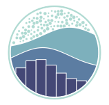
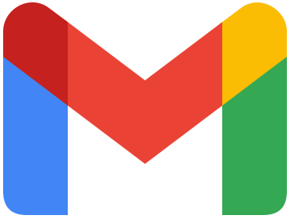

<!-- Profile banner: update the text or colors in the Capsule Render URL to customize it. -->

<!-- Animated Typing -->

  

 
 

<!-- Profile Visitor Counter -->

  

<!-- Animated Pixel Art -->

  

## About Me

I'm a **Computer Science (Artificial Intelligence) graduate** focused on **AI Engineering and Data Engineering**, with hands-on experience developing AI-powered applications and data-driven solutions.

During my **six-month internship**, I applied AI engineering skills to real-world projects, gaining practical experience in **AI application development, sentiment analysis, system integration, and collaborative software development**.

My technical expertise includes **Python, SQL, Pandas, NumPy, scikit-learn, FastAPI, MySQL, and Power BI**, with experience in machine learning, data preprocessing, feature engineering, database design, REST APIs, and workflow automation.

My projects include an **AI-powered e-commerce automation system** integrating **LLM APIs, FastAPI, MySQL, and n8n** to automate order validation, inventory management, and business workflows.

I'm passionate about **building intelligent systems, developing efficient data pipelines, and transforming data into practical, scalable solutions**.

<h2 align="center">Technical Skills</h2>

<h3 align="center">Programming Languages</h3>

  
  
  

<h3 align="center">Machine Learning &amp; Data</h3>

  
  
  
  
  
  
  
  
  

<h3 align="center">Backend</h3>

  
  

<h3 align="center">Frontend</h3>

  
  
  
  

<h3 align="center">DevOps</h3>

  
  
  
  <picture>
    <source media="(prefers-color-scheme: dark)" srcset="./assets/icons/github-dark.svg" />
    
  </picture>
  

---

<h2 align="center">Connect with Me</h2>

  
  &nbsp;&nbsp;&nbsp;
  

<!-- To display this README on your GitHub profile, create a PUBLIC repository named exactly Abdelrahman737, then put this file at its root as README.md. -->
